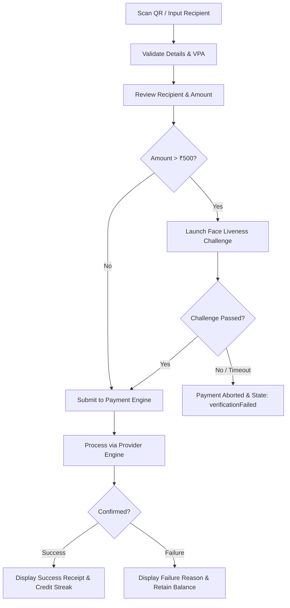

# FacePay — Secure Biometric Payment Application

[](https://flutter.dev)
[](https://flutter.dev)
[](https://flutter.dev)
[]()

> **Core Concept: Scan. Verify. Pay.**  
> FacePay introduces an additional, privacy-preserving layer of on-device biometric security for higher-value digital payments.

---

## 1. Project Overview & Identity

FacePay is a native mobile fintech payment application designed to mitigate unauthorized or coerced digital wallet transfers. Built for **PBL-3 (Project-Based Learning)**, FacePay balances user convenience with rigorous risk controls by requiring an active facial liveness challenge only for payments exceeding a designated threshold.

- **Application Name**: FacePay
- **Application ID / Package**: `com.facepay.app.facepay`
- **Framework**: Flutter 3.24+ / Dart 3.5+
- **Design System**: Material Design 3 (Material 3)
- **Primary Targets**: Android (Native SDK 21–34), Flutter Web (Demonstration & Policy Portal)
- **GitHub Repository**: [https://github.com/adiveena1/FacePay_Application.git](https://github.com/adiveena1/FacePay_Application.git)
- **Live Web & Privacy Portal**: [https://facepayapplication1.vercel.app/privacy-policy](https://facepayapplication1.vercel.app/privacy-policy)

### Academic Attribution & Authors
- **Aditya Veena Maharaj** (System ID: `2024424251`)
- **Gaurav Mudgal** (System ID: `2024278918`)
- **Supervisor**: **Dr. Gaurav Raj**, Associate Professor, Department of Computer Science & Engineering, Sharda University

---

## 2. Non-Negotiable Payment Security Architecture

### Rule A: The ₹500 Biometric Verification Threshold
A centralized security constant enforces the verification threshold across all application screens via `PaymentValidationService`:

```dart
static const double faceVerificationThreshold = 500.0;
```

- **Transactions $\le$ ₹500 (Low-Value)**:
  - Example: ₹100.00, ₹250.50, ₹500.00.
  - The facial liveness challenge is **bypassed** to provide friction-free, instantaneous checkout for routine micro-payments.
  - Transaction proceeds directly through normal payment authorization.
- **Transactions $>$ ₹500 (High-Value)**:
  - Example: ₹500.01, ₹999.00, ₹5,000.00.
  - **Mandatory on-device facial verification** is triggered.
  - Under no circumstances does the application permit client-side bypass for high-value transactions.
  - If verification is denied, fails 3 attempts, or times out (15 seconds), payment submission is immediately aborted.

### Rule B: Strict Workflow Sequencing
The payment workflow strictly adheres to an un-bypassable state machine:

> **Fintech Rule**: A successful face scan is **never** treated as proof that a payment succeeded. Receipts are displayed only after the payment service/provider issues a definitive confirmation reference.

### Rule C: Monetary Precision & Payment Integrity
- **Paise Minor Currency Units**: To prevent IEEE 754 double-precision floating-point rounding errors (e.g. `500.00000000000006`), amounts are calculated in integer minor units (paise, 1 Rupee = 100 Paise) via `CurrencyFormatter.toMinorUnits(amount)`.
- **Recipient VPA Sanitization**: RegEx pattern `^[a-zA-Z0-9.\-_]{2,256}@[a-zA-Z]{2,64}$` ensures recipient addresses conform to valid UPI handles (e.g., `store@icici`, `merchant@okhdfcbank`).
- **Duplicate-Submission Prevention**: In-flight memory lock (`_inFlightKeys`) rejects concurrent taps.
- **Deterministic Idempotency**: `PaymentValidationService.generateIdempotencyKey()` binds user ID, recipient VPA, amount in paise, and nonce into an un-replayable idempotency key.

---

## 3. On-Device Facial Liveness & Zero-Cloud Biometric Policy

FacePay strictly separates **face detection**, **liveness challenges**, and **payment authorization**.

### Zero-Cloud Biometric Privacy Guarantee
```
┌────────────────────────────────────────────────────────┐
│             100% LOCAL DEVICE VOLATILE RAM             │
│                                                        │
│  Front Camera ──> NV21 Frame ──> Google ML Kit ──>     │
│  (Eye Blink + Head Rotation Challenge)                 │
│  [Biometric frames discarded immediately from memory]  │
└──────────────────────────┬─────────────────────────────┘
                           │ Result: PASSED / FAILED / TIMEOUT
                           ▼ (Only Boolean Verification Token)
┌────────────────────────────────────────────────────────┐
│            FIREBASE CLOUD FIRESTORE BACKEND            │
│  - Transaction ID                                      │
│  - Amount (Paise & INR)                                │
│  - Recipient VPA                                       │
│  - Timestamp & Status                                  │
│  [ZERO Face Images, ZERO Coordinates Stored In Cloud]  │
└────────────────────────────────────────────────────────┘
```
- **No Face Images Saved**: Camera frames are processed strictly in volatile RAM and immediately garbage collected.
- **No Biometrics Transmitted**: Neither raw images, video streams, nor facial landmark coordinates are ever transmitted to Firebase, Google Cloud, or third-party servers.
- **No Spoofing Guarantees**: Liveness heuristics (blink & rotation) detect physical responsiveness. They are clearly labeled as challenge heuristics rather than military-grade 3D depth sensors.

### Liveness Challenge Parameters
1. **Eye Blink Detection**:
   - Closed eye observation: Eye open probability $< 0.25$.
   - Open eye observation: Eye open probability $> 0.70$.
2. **Head Turn Observation**:
   - Head rotation Euler Y beyond $+20^\circ$ or $-20^\circ$.
3. **Execution Constraints**:
   - **Maximum Attempts**: 3 attempts before payment lock.
   - **Challenge Timeout**: 15 seconds per attempt (managed by an active countdown timer).

---

## 4. Demonstration & Simulation Mode

FacePay provides a transparent, secure environment for academic evaluators and presentations:
- **Demo Wallet Indicator**: All simulated balances and receipts feature prominent `DEMO WALLET` and `DEMONSTRATION TRANSACTION` banners.
- **Default Test Balance**: ₹25,000.00 mock digital balance (resettable at any time from Settings or Profile).
- **Built-in Evaluator Controls**:
  - `Pass`: Simulates clean completion of both blink and head turn challenges.
  - `Fail`: Simulates a challenge mismatch to test the 3-attempt limit.
  - `Timeout`: Simulates the 15-second challenge expiration to verify automatic transaction cancellation.
- **Sample Test QR Codes**:
  - *Campus Cafeteria*: ₹150.00 (Low-Value $\le$ ₹500, direct payment)
  - *Campus Store*: ₹650.00 (High-Value $>$ ₹500, requires face verification)
  - *Semester Tuition*: ₹5,000.00 (High-Value $>$ ₹500, requires face verification)

---

## 5. Technology Stack & Directory Structure

```
lib/
├── core/
│   ├── constants/
│   │   └── app_constants.dart           # Constants (₹500 threshold, attempt limits)
│   ├── theme/
│   │   └── app_theme.dart               # Material 3 palette & styling
│   └── utils/
│       └── currency_formatter.dart      # Minor unit & Indian currency utilities
├── models/
│   ├── app_user.dart                    # Typed user profile & role model
│   ├── merchant.dart                    # Merchant metadata & VPA
│   ├── payment_transaction.dart         # Full fintech state machine model
│   ├── user_rewards.dart                # Badges, streaks & verification gamification
│   └── verification_result.dart         # Challenge status, attempts & timestamps
├── screens/
│   ├── auth_screen.dart                 # Authentication & 1-Click Demo Login
│   ├── face_verification_screen.dart    # Camera ML Kit & liveness challenge UI
│   ├── home_screen.dart                 # Dashboard, quick actions & balance
│   ├── onboarding_screen.dart           # 3-slide visual security walkthrough
│   ├── payment_confirmation_screen.dart # Security indicator & review
│   ├── payment_result_screen.dart       # Confirmed transaction receipt
│   ├── profile_screen.dart              # User profile, privacy & security status
│   ├── qr_scanner_screen.dart           # Camera QR reader & preset samples
│   ├── settings_screen.dart             # Wallet reset & developer options
│   ├── transaction_details_screen.dart  # Detailed receipt & provider reference
│   └── transaction_history_screen.dart  # Paginated transaction log
├── services/
│   ├── face_detection_service.dart      # Google ML Kit FaceDetector wrapper
│   ├── firebase_service.dart            # Cloud Firestore sync & offline resilience
│   ├── liveness_service.dart            # Multi-frame blink & head turn heuristic engine
│   ├── payment_service.dart             # Payment orchestration, locks & state machine
│   ├── payment_validation_service.dart  # Threshold, VPA regex & idempotency
│   ├── qr_scanner_service.dart          # UPI URI parsing & sanitization
│   ├── rewards_service.dart             # Streaks & security badge storage
│   └── transaction_storage_service.dart # Local SharedPreferences persistence
├── widgets/
│   ├── app_button.dart                  # Consistent Material 3 action buttons
│   ├── reward_badge.dart                # Gamification badge component
│   └── transaction_card.dart            # Transaction item list component
├── firebase_options.dart                # Generated Firebase platform configuration
└── main.dart                            # Application entry point & theme initialization
```

---

## 6. Verification & Automated Testing

FacePay includes an extensive automated test suite covering all critical security and financial constraints:

```bash
# Run static code analysis (0 issues enforced)
flutter analyze

# Execute all automated tests (19/19 tests)
flutter test
```

### Test Coverage Highlights
1. **Threshold Boundary Tests**:
   - `Amount <= ₹500`: No face verification requested.
   - `Amount > ₹500` (e.g. ₹500.01): Mandatory verification enforced.
2. **Monetary Precision Tests**:
   - Conversion to minor units: `500.00` $\rightarrow$ `50000` paise, `500.01` $\rightarrow$ `50001` paise.
   - IEEE 754 precision error prevention.
3. **Fintech Recipient & Currency Security Integrity**:
   - UPI VPA regex validation (`user@bank` accepted, malformed addresses rejected).
   - Currency validation (only `INR` accepted).
   - Deterministic idempotency key generation.
4. **End-to-End Processing Tests**:
   - Bypassing face check on $>$ ₹500 triggers immediate `PaymentStatus.verificationFailed`.
   - Verification timeout triggers cancellation without debiting wallet balance.
   - Overdraft protection (rejects transactions exceeding available balance).

---

## 7. Build & Deployment Instructions

### Local Development Setup
1. **Prerequisites**: Flutter 3.24+, Android Studio, Android SDK 34, JDK 17+.
2. **Clone & Install Dependencies**:
   ```bash
   git clone https://github.com/adiveena1/FacePay_Application.git
   cd FacePay_Application
   flutter pub get
   ```
3. **Run on Emulator or Physical Device**:
   ```bash
   flutter run
   ```

### Production Release Builds (Android)
```bash
# Build Signed Release Android App Bundle (AAB for Google Play Console)
flutter build appbundle --release

# Build Release APK
flutter build apk --release
```
- Signed AAB Output: `build/app/outputs/bundle/release/app-release.aab`
- Release APK Output: `build/app/outputs/flutter-apk/app-release.apk`
- Keystore Configuration: Defined in `android/key.properties` targeting `com.facepay.app.facepay`.

### Play Store Publishing Assets
All marketing graphics and policy documentation are prepared under `play_store_assets/`:
- **App Icon**: 512×512 PNG (`play_store_assets/icon_512.png`)
- **Feature Graphic**: 1024×500 PNG (`play_store_assets/feature_graphic_1024x500.png`)
- **Phone Screenshots**: 4 high-resolution 1080×1920 preview screenshots
- **Privacy Policy**: [https://facepayapplication1.vercel.app/privacy-policy](https://facepayapplication1.vercel.app/privacy-policy)
- **Submission Guide**: Refer to `play_store_assets/PLAY_STORE_SUBMISSION_GUIDE.md`

---

## 8. Academic Declaration

This application and documentation were developed as part of **Project-Based Learning (PBL-3)** in the Department of Computer Science & Engineering at **Sharda University**, under the guidance of **Dr. Gaurav Raj**.
